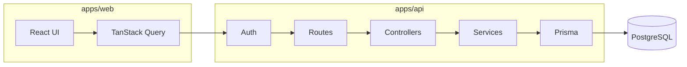
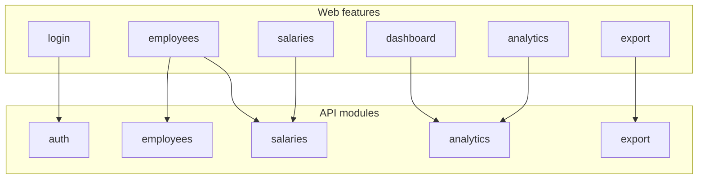

# Remunify - Architecture

> Locked design for a modular monolith (product decisions 2026-11-19).  
> Aligns with [`requirements.md`](./requirements.md).

## Style

**Modular monolith** - one deployable API, clear module boundaries, no microservices.

```text
React (apps/web)
  -> REST JSON (+ Authorization: Bearer)
Express API (apps/api)
  -> services (domain rules)
  -> Prisma
  -> PostgreSQL
```

## Repository layout

| Path                | Responsibility                                                                                                                                            |
| ------------------- | --------------------------------------------------------------------------------------------------------------------------------------------------------- |
| `apps/web`          | Remunify UI (Vite + React + TypeScript)                                                                                                                   |
| `apps/api`          | HTTP API, validation, auth, business logic, Prisma, seed                                                                                                  |
| `docs/`             | Requirements, architecture, database, decisions, [`ai-workflow.md`](./ai-workflow.md), [`performance-considerations.md`](./performance-considerations.md) |
| Root `package.json` | npm workspaces; `npm run dev` runs web + api (colored logs)                                                                                               |

## Request / data flow

```text
Browser
  |  Login -> store bearer token
  |  TanStack Query + Authorization header
  v
HTTP REST (JSON)
  |  Auth middleware (except login/health)
  |  Zod validate at boundary
  v
Route -> Controller
  v
Service (salary raise = insert history row; analytics FX rules)
  v
Prisma Client
  v
PostgreSQL
```

- **Reads (directory, dashboard, analytics):** filter/sort/page/aggregate in SQL; current salary = latest `effectiveFrom`; return only fields the view needs.
- **Writes (salary raise):** validate; insert new salary row; prior rows remain; return updated current + history as needed.
- **Export:** authenticated endpoints stream/download CSV or Excel built from current compensation data.
- **Errors:** consistent JSON for 400/401/404/409/500. No stack traces to clients.

## Backend modules

| Module      | Owns                                                                           |
| ----------- | ------------------------------------------------------------------------------ |
| `auth`      | Login; issue bearer token; protect routes; single HR user                      |
| `employees` | List/search/filter/sort/paginate; get by id (includes current salary for list) |
| `salaries`  | Current get/update (raise); history list for detail                            |
| `analytics` | Per-currency aggregates; company-wide USD via fixed `FxRate`                   |
| `export`    | CSV + Excel export of directory/compensation snapshots                         |

## Frontend feature areas

| Area        | Screens / jobs                                                     |
| ----------- | ------------------------------------------------------------------ |
| `auth`      | Login (no registration)                                            |
| `dashboard` | Headcount; per-currency + country/department; labeled USD total    |
| `employees` | Directory (current salary column) + detail (history timeline)      |
| `salaries`  | Edit current annual pay on detail (triggers history insert)        |
| `analytics` | Breakdown views with currency + cohort; USD rollup labeled demo FX |
| `export`    | Export actions (CSV / Excel)                                       |

UI stack: Tailwind + shadcn/ui; modern minimal chrome.

## Cross-cutting

| Concern       | Approach                                                        |
| ------------- | --------------------------------------------------------------- |
| Validation    | Zod on API inputs; DB constraints where useful                  |
| Money         | Decimal in DB; currency on every amount; annual period in v1    |
| Auth          | Bearer token; one HR user; no public write APIs                 |
| FX            | Fixed demo rates table/config; never silent cross-currency sums |
| Config        | Env for DB URL, ports, JWT/secret, demo HR password if needed   |
| Observability | Structured logs on API                                          |

## Diagram - runtime



## Diagram - module boundaries



## Non-goals for this architecture

- Microservices, message buses, Kubernetes
- Shared “god” utils package without a clear need
- Client-side aggregation over the full 10k employee set
- Live FX provider calls in v1

## Product decisions (applied)

| ID     | Outcome                                            |
| ------ | -------------------------------------------------- |
| **Q1** | History service + insert-on-raise; detail timeline |
| **Q2** | Per-currency analytics + USD demo FX rollup        |
| **Q3** | Auth module + protected routes + login UI          |
| **Q4** | email, joinedAt; annual only; no components        |
| **Q5** | Export module (CSV + Excel); import later          |
