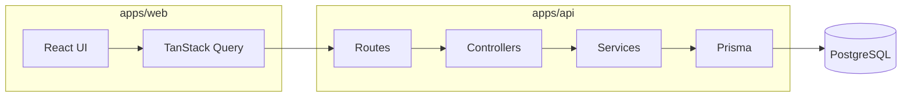
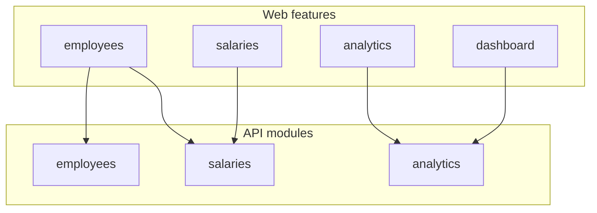

# Remunify - Architecture

> Provisional design for a modular monolith. Aligns with [`requirements.md`](./requirements.md).  
> Auth, import/export, and salary-history flows stay out until clarifications **Q1 / Q3 / Q5** are answered.

## Style

**Modular monolith** - one deployable API, clear module boundaries, no microservices.

```text
React (apps/web)
  -> REST JSON
Express API (apps/api)
  -> services (domain rules)
  -> Prisma
  -> PostgreSQL
```

## Repository layout

| Path                | Responsibility                                                        |
| ------------------- | --------------------------------------------------------------------- |
| `apps/web`          | Remunify UI (Vite + React + TypeScript)                               |
| `apps/api`          | HTTP API, validation, business logic, Prisma, seed                    |
| `docs/`             | Requirements, architecture, database, decisions, AI/performance notes |
| Root `package.json` | npm workspaces; `npm run dev` runs web + api (colored logs)           |

## Request / data flow

```text
Browser
  |  TanStack Query (planned)
  v
HTTP REST (JSON)
  |  Zod validate at boundary
  v
Route -> Controller (HTTP map / status codes)
  v
Service (rules: salary update, analytics semantics)
  v
Prisma Client
  v
PostgreSQL
```

- **Reads (directory, dashboard, analytics):** filter/sort/page/aggregate in SQL; return only fields the view needs.
- **Writes (salary update):** validate input; persist with decimal money + currency; return updated resource or typed error.
- **Errors:** consistent JSON for validation (400), not found (404), conflict (409), unexpected (500). No stack traces to clients.

## Backend modules

| Module      | Owns                                                                                   |
| ----------- | -------------------------------------------------------------------------------------- |
| `employees` | List/search/filter/sort/paginate; get by id                                            |
| `salaries`  | Current compensation get/create/update (**Q1:** history later if required)             |
| `analytics` | Aggregations by department/country (and similar); **Q2:** never mix currencies blindly |

Optional later (blocked until clarifications):

| Module          | Blocker |
| --------------- | ------- |
| `auth`          | **Q3**  |
| `import-export` | **Q5**  |

## Frontend feature areas

| Area        | Screens / jobs                                                   |
| ----------- | ---------------------------------------------------------------- |
| `dashboard` | Headcount and currency-safe summaries                            |
| `employees` | Directory + detail                                               |
| `salaries`  | Edit current pay on employee detail (**Q1:** history UI blocked) |
| `analytics` | Breakdown views with explicit currency/cohort                    |

UI stack direction: Tailwind + shadcn/ui (or equivalent); modern minimal chrome. See project plan UI quality bar.

## Cross-cutting

| Concern       | Approach                                                               |
| ------------- | ---------------------------------------------------------------------- |
| Validation    | Zod on API inputs; mirror constraints in DB where useful               |
| Money         | Decimal/numeric in DB; currency code on every amount; no float storage |
| Auth          | None in provisional v1 (**Q3**)                                        |
| Config        | Env vars for DB URL, ports; `.env` gitignored                          |
| Observability | Structured logs on API; enough to debug locally and in deploy          |

## Diagram - runtime



## Diagram - module boundaries



## Non-goals for this architecture

- Microservices, message buses, Kubernetes
- Shared “god” utils package without a clear need
- Client-side aggregation over the full 10k employee set

## Open clarification impact

| ID     | Architecture impact when answered                          |
| ------ | ---------------------------------------------------------- |
| **Q1** | May add history service methods + transactional write path |
| **Q2** | Analytics service rules for totals / conversion            |
| **Q3** | Auth middleware and protected routes                       |
| **Q4** | DTO/schema field lists                                     |
| **Q5** | New import/export module and endpoints                     |
