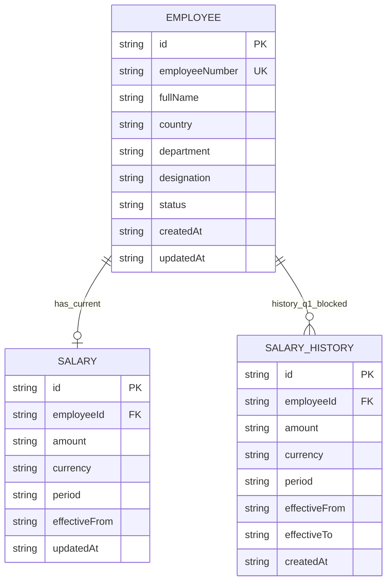

# Remunify - Database Design

> Provisional relational model for PostgreSQL + Prisma.  
> Aligns with [`requirements.md`](./requirements.md) and [`architecture.md`](./architecture.md).  
> **Do not lock** history tables (**Q1**), final attribute lists (**Q4**), or cross-currency totals (**Q2**) until Incubyte replies.  
> **Implemented draft:** `apps/api/prisma/schema.prisma` + migration `20261117163000_init_provisional`. Assumptions: `apps/api/prisma/ASSUMPTIONS.md`.

## Principles

- Money: `DECIMAL` / Prisma `Decimal` - **never** float/double for stored amounts
- Every salary amount has an explicit **ISO currency code**
- Pay period is explicit (provisional default: `ANNUAL`)
- Synthetic seed only; deterministic where practical; **>= 10,000 employees**
- Prefer indexes that match real list/filter/sort/analytics queries
- No invented FX rates; analytics stay per-currency unless **Q2** says otherwise

## Provisional entities (v1 draft)

### Employee

| Column                    | Type (logical) | Notes                          |
| ------------------------- | -------------- | ------------------------------ |
| `id`                      | UUID / cuid    | Primary key                    |
| `employeeNumber`          | string         | Unique business id; searchable |
| `fullName`                | string         | Searchable                     |
| `country`                 | string         | Filter / analytics dimension   |
| `department`              | string         | Filter / analytics dimension   |
| `designation`             | string         | Job title; filter optional     |
| `status`                  | enum           | e.g. `ACTIVE`, `INACTIVE`      |
| `createdAt` / `updatedAt` | timestamps     | Audit                          |

**Q4:** Contact fields, more HR attributes, or salary _components_ (bonus, allowance) only if clarifications require them.

### Salary (current compensation)

One **current** salary row per employee in the provisional model (**Q1:** history deferred).

| Column          | Type (logical) | Notes                                               |
| --------------- | -------------- | --------------------------------------------------- |
| `id`            | UUID / cuid    | Primary key                                         |
| `employeeId`    | FK -> Employee | Unique in provisional “current only” model          |
| `amount`        | decimal        | Stored precisely                                    |
| `currency`      | char(3)        | e.g. `USD`, `INR`, `EUR`                            |
| `period`        | enum           | Provisional: `ANNUAL` (extend if needed)            |
| `effectiveFrom` | date           | Optional even without full history; useful metadata |
| `updatedAt`     | timestamp      | Last change                                         |

**Q1:** If history is required, replace or extend with a `SalaryHistory` (or versioned rows) model: multiple rows per employee, effective dating, clear “current” rule, no overlapping periods.

## ER diagram (provisional)

Solid boxes = planned for provisional v1. Dashed = **blocked on Q1** (do not implement until clarified).

Note: `Salary.employeeId` is unique in the provisional schema (one current salary). `SALARY_HISTORY` is design-only until **Q1**.

Same diagram is the project **ER artifact** (also linked from the plan). No separate image file required unless we export one later.

## Relationships

| From     | To            | Cardinality (provisional) | Rule                                        |
| -------- | ------------- | ------------------------- | ------------------------------------------- |
| Employee | Salary        | 1:0..1                    | At most one current salary row              |
| Employee | SalaryHistory | 1:0..n                    | **Q1 only** - not in provisional migrations |

## Indexes (planned)

| Index                                                      | Why                                 |
| ---------------------------------------------------------- | ----------------------------------- |
| `Employee.employeeNumber` unique                           | Lookup / search                     |
| `(Employee.fullName)` or trigram/search strategy as needed | Name search                         |
| `(Employee.country, Employee.department)`                  | Common filters + analytics group-by |
| `(Employee.status)`                                        | Active cohort filters               |
| `Salary.employeeId` unique (current model)                 | Join + enforce one current row      |
| `(Salary.currency)`                                        | Per-currency aggregates (**Q2**)    |

Add more only when query plans show need.

## Money and currency rules (provisional / Q2)

| Rule      | Provisional behavior                                                             |
| --------- | -------------------------------------------------------------------------------- |
| Store     | Decimal amount + currency code always together                                   |
| Aggregate | Group by `currency` (and dimension); **do not** sum INR+USD into one “total pay” |
| Display   | Label every metric with currency and population size                             |
| FX        | None until **Q2** provides a rule                                                |

## Seed expectations

- Insert **10,000** employees with realistic synthetic distributions across countries/departments/currencies
- Each active employee gets a current `Salary` row under the provisional model
- Re-runnable / documented from `apps/api` (exact scripts in README when implemented)

## Clarification impact

| ID     | Schema impact                                                                                       |
| ------ | --------------------------------------------------------------------------------------------------- |
| **Q1** | Introduce `SalaryHistory` (or equivalent); redefine how “current” is derived; transactional updates |
| **Q2** | Possibly a reporting currency table or conversion policy - only if they require it                  |
| **Q3** | Optional `User` / session tables if auth is required                                                |
| **Q4** | Extra columns or child tables for compensation components                                           |
| **Q5** | No persistent schema required for one-off import jobs; maybe import-run audit table if useful       |

## Out of scope for the data model

- Payroll ledgers, bank accounts, payslip line items
- Tax tables by jurisdiction
- FX rate time series (unless **Q2** forces a simple approach)
