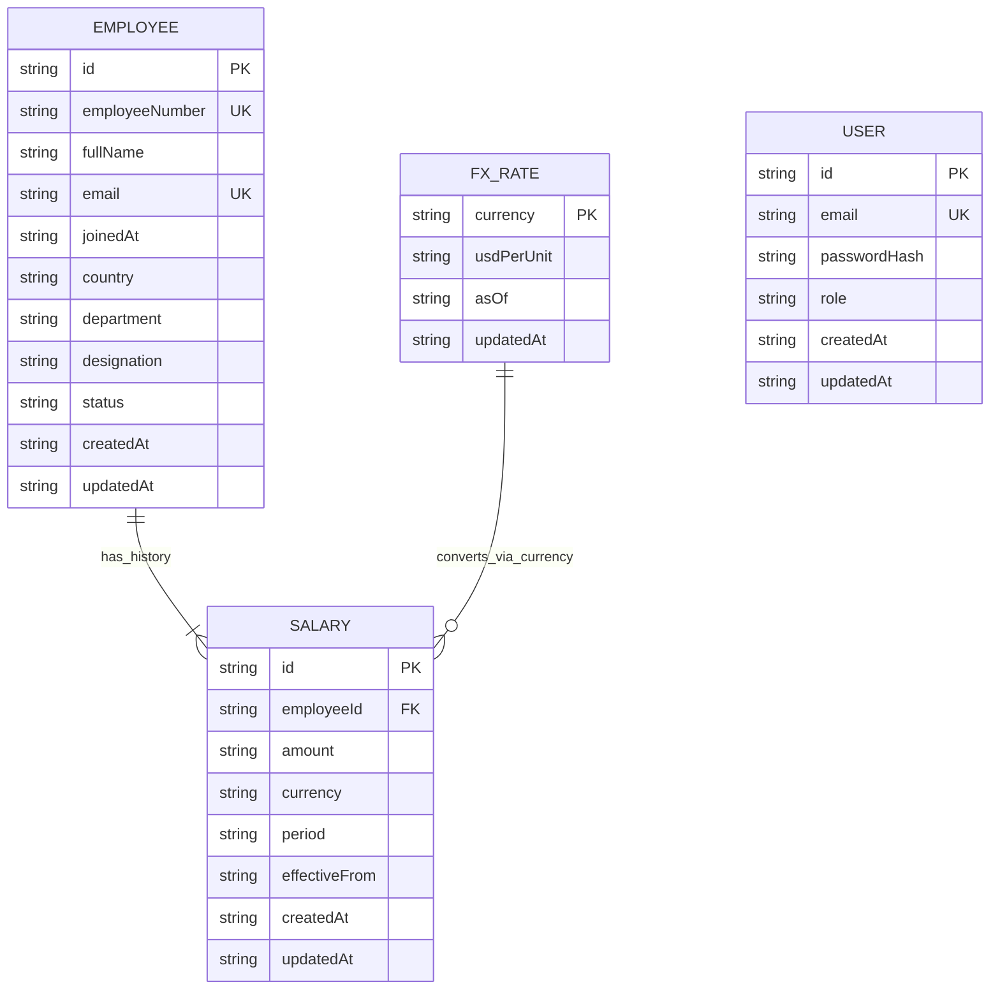

# Remunify - ER Diagram

Canonical Mermaid ER for the locked v1 data model. Entity details and indexes: [`database-design.md`](./database-design.md).  
Product decisions: [`requirements.md`](./requirements.md).

- **User** - single HR login
- **Employee** - includes email + joining date
- **Salary** - multiple rows per employee (history); current = latest `effectiveFrom`
- **FxRate** - fixed demo USD conversion rates

`User` has no FK to `Employee` in v1 (HR login only). `Salary.currency` matches `FxRate.currency` for labeled USD company totals.
